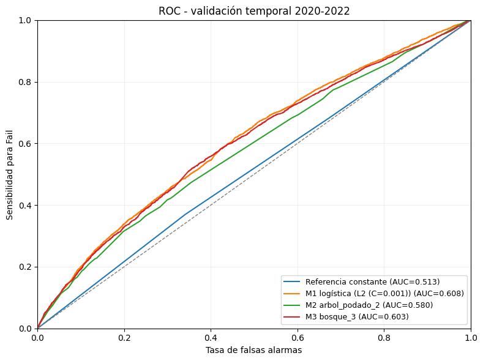
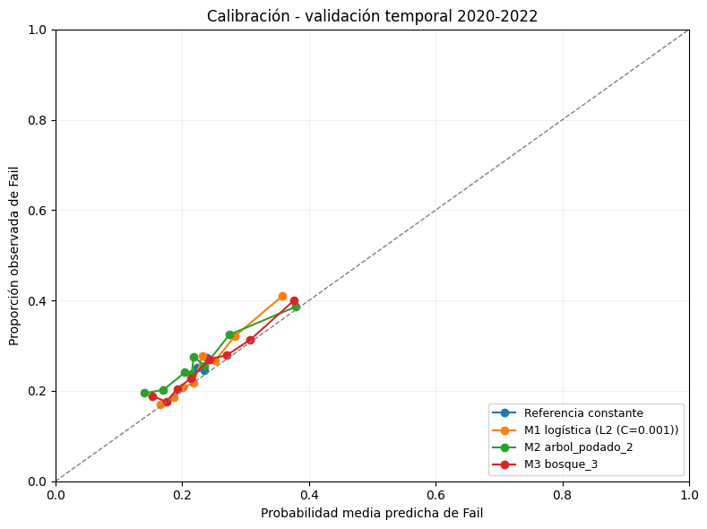
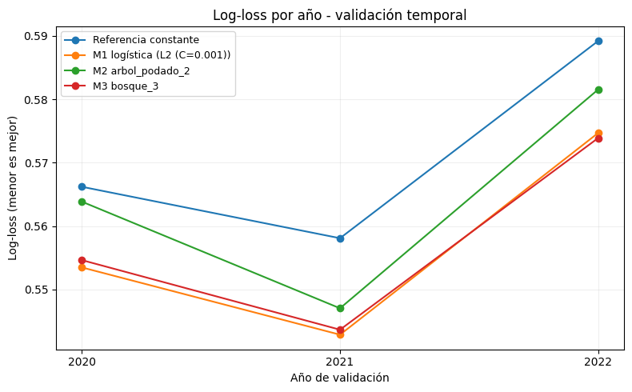

```{python}
#| label: ejecutar-analisis
#| include: false
#| echo: false

from pathlib import Path
import json
import re

import numpy as np
import pandas as pd
import matplotlib.pyplot as plt

from matplotlib.patches import FancyBboxPatch
from IPython.display import Markdown, display
from sklearn.metrics import (
    confusion_matrix,
    ConfusionMatrixDisplay,
    roc_curve,
    roc_auc_score
)

# Leer el notebook.
notebook = json.loads(
    Path("main.ipynb").read_text(encoding="utf-8")
)
celdas = notebook["cells"]

# Ejecutar preparación, M0, M1, M2 y M3 del notebook completo.
# No ejecutar la comparación global ni la reserva final.
limite = next(
    (i for i, celda in enumerate(celdas)
     if celda["cell_type"] == "markdown"
     and "Comparación de todos los modelos" in "".join(celda["source"])),
    len(celdas)
)

analisis = {"__name__": "__analisis_informe__"}
for numero, celda in enumerate(celdas[:limite], start=1):
    if celda["cell_type"] == "code":
        codigo = "".join(celda["source"])
        exec(compile(codigo, f"main.ipynb:celda_{numero}", "exec"), analisis)
plt.close("all")

# BASES.
datos = analisis["datos"]
datos_canvass = analisis["datos_canvass"]
desarrollo = analisis["desarrollo"]
reserva = analisis["reserva"]

# PREDICTORES.
numericas = analisis["numericas"]
categoricas = analisis["categoricas"]
predictores = numericas + categoricas

# CONTEOS.
n_originales = analisis["n_originales"]
n_illinois = analisis["n_illinois"]
n_chicago = analisis["n_chicago"]
n_canvass_todos = analisis["n_canvass_todos"]

# TABLAS DESCRIPTIVAS.
tabla_flujo = analisis["tabla_flujo"]
tabla_particiones = analisis["tabla_particiones"]
tabla_faltantes = analisis["tabla_faltantes"]
tabla_resultado = analisis["tabla_resultado"]
tabla_historia = analisis["tabla_historia"]
tabla_repeticion = analisis["tabla_repeticion"]
resumen_anual = analisis["resumen_anual"]
resumen_numericas = analisis["resumen_numericas"]

# RESULTADOS Y CONFIGURACIÓN DE M2.
tabla_m2 = analisis["tabla_modelos_m2"].copy()
predicciones_m2 = analisis["predicciones_m2"]
parametros_m2 = analisis["parametros_m2"]

modelo_arbol = analisis["modelo_arbol"]
modelo_svm = analisis["modelo_svm"]
modelo_m2 = analisis["modelo_m2"]

umbral_m2 = analisis["umbral_fail"]
elegidos_m2 = [modelo_arbol, modelo_svm]

# Comprobar los modelos seleccionados.
if (
    not modelo_arbol.startswith("arbol_podado_")
    or not modelo_svm.startswith("svm_")
):
    raise ValueError(
        "Revisa la elección de árbol y SVM en main.ipynb."
    )

if modelo_m2 not in elegidos_m2:
    raise ValueError(
        "El M2 final debe ser uno de los dos candidatos elegidos."
    )

if not np.allclose(tabla_m2["umbral_fail"], umbral_m2):
    raise ValueError(
        "La tabla M2 y las matrices deben utilizar el mismo umbral."
    )

# Recuperar las métricas y los parámetros seleccionados.
metricas_elegidos_m2 = (
    tabla_m2
    .set_index("modelo")
    .loc[elegidos_m2]
)

fila_arbol_m2 = metricas_elegidos_m2.loc[modelo_arbol]
fila_svm_m2 = metricas_elegidos_m2.loc[modelo_svm]

fila_final_m2 = (
    tabla_m2
    .set_index("modelo")
    .loc[modelo_m2]
)

parametros_finales_m2 = parametros_m2[modelo_m2]

# FUNCIONES DE PRESENTACIÓN.
def nombre_modelo_m2(nombre):

    if nombre.startswith("arbol_podado_"):
        return "Árbol " + nombre.rsplit("_", 1)[1]

    return "SVM " + nombre.rsplit("_", 1)[1]


def decimal_informe(valor, decimales=4):
    return f"{float(valor):.{decimales}f}".replace(".", ",")


def entero_informe(valor):
    return f"{int(valor):,}".replace(",", ".")
```

```{python}
#| label: preparar-auditoria
#| include: false
#| echo: false

# Recuperar las copias conservadas en el notebook.
datos_originales = analisis["datos_originales"]
datos_identificados = analisis["datos_identificados"]

# Recuperar las funciones utilizadas en el análisis.
limpiar_texto = analisis["limpiar_texto"]
homologar_ciudad = analisis["homologar_ciudad"]

# Seleccionar las filas originales de Illinois y Chicago.
mascara_geografica = (
    datos_originales["state"].eq("IL")
    & homologar_ciudad(
        datos_originales["city"]
    ).eq("CHICAGO")
).fillna(False)

originales_chicago = datos_originales.loc[
    mascara_geografica
].copy()

# Seleccionar las Canvass con resultado binario elegible.
originales_canvass = originales_chicago.loc[
    originales_chicago["inspection_type"].eq("Canvass")
    & originales_chicago["results"].isin(
        ["Fail", "Pass", "Pass w/ Conditions"]
    )
].copy()

# Comprobar que las selecciones coinciden con el análisis.
if len(originales_chicago) != len(datos):
    raise ValueError(
        "La selección geográfica de la auditoría "
        "no coincide con datos."
    )

if len(originales_canvass) != len(datos_canvass):
    raise ValueError(
        "La selección Canvass de la auditoría "
        "no coincide con datos_canvass."
    )

# FUNCIONES PARA PRESENTAR LOS CONTEOS Y LAS TABLAS.
def formato_conteo(valor):
    return entero_informe(valor)


def mostrar_tabla(tabla):
    """Mostrar una tabla con los conteos formateados."""

    salida = tabla.copy()

    for columna in salida.columns:

        if pd.api.types.is_numeric_dtype(salida[columna]):
            salida[columna] = (
                salida[columna]
                .map(formato_conteo)
            )

    display(
        Markdown(
            salida.to_markdown(
                index=False,
                disable_numparse=True
            )
        )
    )
```


# Resumen ejecutivo
se evaluó la capacidad de predicción para resultados sanitarios negativos (*fail*) en inspecciones rutinarias (*canvass*) de establecimientos alimenticios de Chicago. Se cuenta con una base de 43.216 inspecciones con respuesta binaria, de las cuales 27.369 pertenecen al desarollo (2019-2022) y 15.847 a la reserva (2023-2024). Los antecedentes correspondientes a cada local, se construyeron a partir de la información disponible a partir de la visita anterior a la inspección obejtivo. 

Se comparó el modelo de referencia (*regresión logística simple*) con; una regresión logística (M1), árbol podado o SVM (M2) y ensambles (M3). La selección se realizó con ventanas temporales crecientes y considerando el mejor desempeño de ROC-AUC y Log-loss. **M1 con penalización L2 y \(C=0{,}001\)** Presentó el mayor ROC-AUC de validación (**0,6084**) y log-loss (**0,5574**), seguido por un bosque aleatorio con AUC (**0,6037**) y log-loss(**0,5579**).


# Problema y datos


## Formulación del problema

El objetivo del estudio es predecir qué inspecciones rutinarias de establecimientos de alimentos de Chicago, Estados Unidos, tienen mayor probabilidad de terminar en un resultado $\textbf{Fail}$. El análisis está dirigido al Departamento de Salud Pública de Chicago (CDPH) y podría apoyar la priorización de inspecciones según su probabilidad estimada de incumplimiento sanitario.

La base original contiene inspecciones de distintos tipos. Para el resultado principal se consideran las inspecciones rutinarias de tipo Canvass realizadas entre $2019$ y $2024$, cuyos resultados sean $\textbf{Fail, Pass o Pass w/ Conditions}$. La unidad de observación es una inspección elegible, por tanto, un mismo establecimiento puede aportar varias observaciones. La respuesta es binaria y se codifica como 0 para Fail y 1 para Pass o Pass w/ Conditions. El modelo entrega una probabilidad de Fail entre 0 y 1. Los demás resultados se cuantifican y excluyen de esta definición binaria.

Se plantea emitir la predicción el día anterior a la visita, bajo el supuesto de que la inspección ya está programada. Solo se utiliza información disponible en ese momento, como el tipo de establecimiento y los antecedentes de inspecciones de fechas anteriores. Se supone que dichos antecedentes ya están registrados y disponibles al predecir. Se excluyen los resultados y hallazgos de la inspección actual, las visitas futuras y las del mismo día cuando se desconoce su orden.

Los datos representan únicamente establecimientos inspeccionados, cuya frecuencia de visita puede depender o no de su nivel de riesgo. Por ello, las conclusiones no estiman la seguridad sanitaria de todos los establecimientos de Chicago. Las asociaciones identificadas tienen una interpretación predictiva y no permiten afirmar que una característica cause el resultado.

## Procedencia de los datos

Los datos provienen del conjunto Food Inspections del portal de datos abiertos de la ciudad de Chicago, producido por el Chicago Department of Public Health. Se utiliza la copia proporcionada por el curso, fechada el 12 de octubre de 2026, correspondiente al periodo 2019–2024.

La interpretación de las variables se apoya en el diccionario entregado con el caso. Cuando la documentación no permite establecer con certeza la identificación de un local o la disponibilidad temporal de una variable, se aplican reglas explícitas y reproducibles, cuyas limitaciones se describen en las siguientes secciones.

## Construcción de la base analítica

### Normalización e identificación de establecimientos

La preparación comienza con la normalización de las variables de texto. Se considera válida una licencia formada exclusivamente por dígitos y con al menos uno distinto de cero, cumple la función de identificador.

Se distingue entre el identificador de inspección, `inspection_id`, y el identificador del establecimiento, `id_local`. El primero identifica una visita y permite comprobar posibles duplicaciones de inspecciones, el segundo permite enlazar las visitas de un mismo local. Para construir `id_local` se combina una licencia válida con una dirección normalizada.

Las diferencias en el nombre no separan la historia cuando coinciden licencia y dirección. Las licencias distintas se mantienen separadas y las sucursales de una franquicia conservan historias propias. Cuando no es posible identificar el establecimiento con seguridad, la inspección se conserva si cumple los demás criterios de inclusión. Se construye el indicador `historia_no_identificable`, que toma el valor verdadero cuando no puede asignarse un `id_local`. Esta situación se distingue de un establecimiento identificado sin visitas previas observadas.

### Filtros geográficos y selección de inspecciones

Posteriormente limitamos los registros al estado de Illinois y a la ciudad de Chicago. Para la ciudad se aplica una lista explícita de variantes de escritura. Los antecedentes se construyen utilizando las inspecciones de cualquier tipo retenidas tras los filtros geográficos. Para la base analítica se seleccionan únicamente las inspecciones Canvass con resultado Fail, Pass o Pass w/ Conditions. Se mantienen todas las visitas elegibles, sin reducir cada establecimiento a su primera o última inspección.

La @tbl-construccion resume la cantidad de inspecciones conservadas y excluidas en cada etapa de construcción.

```{python}
#| label: tbl-construccion
#| tbl-cap: "Construcción de la base analítica: inspecciones conservadas y excluidas."

from IPython.display import Markdown, display

# Recuperar la tabla que ya se calculó en main.ipynb.
tabla_construccion = analisis["tabla_flujo"][
  [
    "etapa",
    "n_inspecciones",
    "excluidas_en_etapa",
    "porcentaje_original"
  ]
].copy()

# Nombres que aparecerán en el informe.
tabla_construccion = tabla_construccion.rename(
  columns={
    "etapa": "Etapa",
    "n_inspecciones": "Conservadas",
    "excluidas_en_etapa": "Excluidas",
    "porcentaje_original": "Original (%)"
  }
)

# Mostrar conteos con punto como separador de miles.
# La primera etapa no tiene una etapa anterior: aparece un guion.
for columna in ["Conservadas", "Excluidas"]:
  tabla_construccion[columna] = (
    tabla_construccion[columna].map(
      lambda valor: (
        "—"
        if pd.isna(valor)
        else f"{int(valor):,}".replace(",", ".")
      )
    )
  )

# Porcentajes con dos decimales y coma decimal.
tabla_construccion["Original (%)"] = (
  tabla_construccion["Original (%)"].map(
    lambda valor: f"{valor:.2f}".replace(".", ",")
  )
)

# Presentar una tabla que Quarto incorporará al PDF.
display(
  Markdown(
    tabla_construccion.to_markdown(
      index=False,
      disable_numparse=True
    )
  )
)
```

La @tbl-identificacion distingue el número de inspecciones del número de establecimientos identificados en cada etapa. Una misma identificación puede aparecer en varias inspecciones. Los registros sin identificador se conservan cuando cumplen los criterios de inclusión y no se interpretan como establecimientos distintos entre sí.

```{python}
#| label: tbl-identificacion
#| tbl-cap: "Identificación de establecimientos en las distintas bases."
#| echo: false

bases_identificacion = {
  "Original": datos_identificados,
  "Illinois y Chicago": datos,
  "Canvass": datos_canvass
}

filas_identificacion = []

for nombre, base_actual in bases_identificacion.items():
  
  filas_identificacion.append({
    "Base": nombre,
    "Inspecciones": len(base_actual),
    "Con ID": int(base_actual["id_local"].notna().sum()),
    "Sin ID": int(base_actual["id_local"].isna().sum()),
    "Locales distintos": base_actual["id_local"].nunique(
      dropna=True
    )
  })

tabla_identificacion = pd.DataFrame(filas_identificacion)

mostrar_tabla(tabla_identificacion)
```

### Auditoría de valores faltantes

La auditoría de la base original no detectó filas completamente duplicadas ni valores repetidos entre los identificadores de inspección no faltantes (`inspection_id`). Por lo tanto, no fue necesario eliminar registros por duplicación. Las distintas inspecciones de un mismo establecimiento se conservaron, pues corresponden a observaciones diferentes.

La @tbl-auditoria-insumos resume la disponibilidad y los códigos especiales de los campos originales utilizados en la preparación. Se distinguen valores faltantes reconocidos al leer el archivo, textos vacíos y valores que requieren tratamiento específico. Los conteos se presentan por base, cuyo tamaño se indica como denominador.

```{python}
#| label: tbl-auditoria-insumos
#| tbl-cap: "Auditoría de los campos originales antes de su transformación."
#| echo: false

def fragmentos_no_interpretables(texto):
    """Detectar fragmentos sin un código inicial seguido de punto."""

    fragmentos = [
        parte.strip()
        for parte in str(texto).split("|")
        if parte.strip()
    ]

    return (
        not fragmentos
        or any(
            re.match(r"^[0-9]+\.", parte) is None
            for parte in fragmentos
        )
    )


def auditar_insumos(base_actual, nombre_base):

    variables = {
        "license_": "Licencia",
        "address": "Dirección",
        "inspection_date": "Fecha",
        "facility_type": "Tipo de establecimiento",
        "risk": "Riesgo",
        "violations": "Advertencias"
    }

    filas = []

    for columna, nombre_variable in variables.items():

        texto = base_actual[columna].astype("string")
        normalizado = limpiar_texto(texto)

        faltante = texto.isna()

        vacio = (
            texto.notna()
            & texto.str.strip().eq("").fillna(False)
        )

        presente = ~(faltante | vacio)

        especial = pd.Series(
            False,
            index=base_actual.index
        )

        if columna == "license_":

            licencia = normalizado.str.replace(
                r"\.0+$",
                "",
                regex=True
            )

            licencia_valida = (
                licencia.str.fullmatch(r"[0-9]+", na=False)
                & licencia.str.contains(r"[1-9]", na=False)
            )

            especial = ~licencia_valida

        elif columna in ["address", "facility_type"]:

            especial = normalizado.isin([
                "0", "UNKNOWN", "UNKOWN", "N/A",
                "NA", "NULL", "(NULL)", "NONE"
            ])

        elif columna == "inspection_date":

            especial = pd.to_datetime(
                texto,
                errors="coerce"
            ).isna()

        elif columna == "risk":

            # All se conserva como categoría propia en el análisis.
            especial = ~normalizado.isin([
                "RISK 1 (HIGH)",
                "RISK 2 (MEDIUM)",
                "RISK 3 (LOW)"
            ])

        elif columna == "violations":

            especial.loc[presente] = (
                texto.loc[presente]
                .map(fragmentos_no_interpretables)
            )

        # No contar faltantes o vacíos también como especiales.
        especial = especial.fillna(False) & presente

        filas.append({
            "Base": nombre_base,
            "Variable": nombre_variable,
            "Total": len(base_actual),
            "NA": int(faltante.sum()),
            "Vacíos": int(vacio.sum()),
            "Especiales": int(especial.sum())
        })

    return pd.DataFrame(filas)


tabla_auditoria_insumos = pd.concat(
    [
        auditar_insumos(
            datos_originales,
            "Original"
        ),
        auditar_insumos(
            originales_canvass,
            "Canvass elegibles"
        )
    ],
    ignore_index=True
)

mostrar_tabla(tabla_auditoria_insumos)
```

En esta tabla, “Especiales” corresponde a licencias que no cumplen la regla de validez, información desconocida en dirección y tipo de establecimiento, riesgos distintos de los tres niveles conocidos y textos de infracciones con fragmentos cuyo código no puede extraerse. Su identificación no implica que todos estos registros se eliminen.

## Construcción y disponibilidad de los predictores

Los predictores combinan características del establecimiento y antecedentes de inspecciones anteriores. Los antecedentes históricos se construyen por establecimiento y fecha, considerando visitas de cualquier tipo realizadas en fechas estrictamente anteriores. Se excluyen la visita actual, las futuras y todas las del mismo día cuando se desconoce su orden. Se supone que la información histórica ya está registrada y disponible al emitir la predicción.

Como antecedentes acumulados se construyen el número de visitas previas, el número de resultados Fail previos y la proporción histórica de Fail. Esta última divide el número de Fail por el total de visitas anteriores de cualquier tipo y resultado. Por tanto, representa la proporción de visitas registradas que terminaron en Fail, y no exclusivamente la proporción de reprobaciones entre inspecciones con resultado sanitario evaluable. La proporción queda como faltante cuando no existen visitas previas observadas o no puede enlazarse la historia.

Otro antecedente corresponde al tiempo transcurrido desde la última fecha de inspección anterior. Se calcula la diferencia en días y se divide por 30 para expresarla en meses aproximados. Cuando no existe una fecha previa enlazable, la variable queda como faltante.

El tipo de establecimiento se agrupa mediante reglas semánticas explícitas aplicadas a su descripción. Se distinguen restaurantes, almacenes, escuelas, cuidado infantil, salud y adulto mayor, panaderías, catering y cocina compartida, además de Otro y Desconocido. Otro reúne descripciones no reconocidas por las reglas y Desconocido representa información faltante. Se supone que esta característica del local es conocida antes de la visita.

Como no se conoce con certeza cuándo se asigna el riesgo de una inspección, se utiliza el correspondiente a la última fecha anterior. Si en esa fecha existen varios niveles conocidos, se conserva el más alto. Los códigos son 1 para alto, 2 para medio y 3 para bajo. Cuando no existe un nivel conocido, pero aparece All, se conserva como categoría 4, sin atribuirle un nivel específico. La falta de riesgo previo disponible se representa mediante el código 0, tratado como categoría y no como riesgo bajo.

El antecedente de infracciones corresponde al número de códigos distintos registrados entre todas las inspecciones de la última fecha anterior. Los códigos repetidos en esa fecha se cuentan una sola vez. Cuando falta el texto de alguna inspección de esa fecha o un fragmento con contenido no permite extraer un código, el conteo se considera faltante. No se interpreta la ausencia de texto como ausencia de infracciones ni se utiliza el detalle de la visita que se intenta predecir.

Finalmente, se incorpora el indicador de historia no identificable para distinguir los registros cuyo establecimiento no pudo enlazarse con seguridad. Los identificadores, los nombres y la dirección se utilizan para la construcción y auditoría de la base, pero no se incluyen directamente como predictores del modelo base.

La @tbl-diccionario-predictores reúne los ocho predictores del modelo base, sus interpretaciones, sus tipos de variable y las condiciones de disponibilidad temporal utilizadas.

```{python}
#| label: tbl-diccionario-predictores
#| tbl-cap: "Diccionario de predictores del modelo base."
#| echo: false
#| tbl-colwidths: [25, 40, 15, 20]

import pandas as pd
from IPython.display import Markdown, display

diccionario_predictores = pd.DataFrame(
  [
    (
      "n_visitas_previas",
      "Cantidad de inspecciones anteriores de cualquier tipo.",
      "Numérica discreta",
      "Acumulado hasta antes del día de la visita.",
      "Incluida"
    ),
    (
      "n_fail_previos",
      "Cantidad de resultados Fail en las inspecciones anteriores.",
      "Numérica discreta",
      "Acumulado hasta antes del día de la visita.",
      "Incluida"
    ),
    (
      "prop_fail_previa",
      "Número de Fail previos dividido por el total de visitas previas.",
      "Numérica",
      "Calculada con fechas anteriores.",
      "Incluida"
    ),
    (
      "n_tipos_infraccion_previos",
      "Cantidad de códigos de infracción distintos en la última fecha anterior.",
      "Numérica discreta",
      "Última fecha de inspección anterior.",
      "Incluida"
    ),
    (
      "meses_desde_ultima_visita",
      "Días desde la última fecha anterior, divididos por 30.",
      "Numérica",
      "Fechas anteriores y fecha programada.",
      "Incluida"
    ),
    (
      "tipo_establecimiento",
      "Grupo asignado mediante reglas sobre el tipo de establecimiento.",
      "Categórica",
      "Se supone conocido antes de la visita.",
      "Incluida"
    ),
    (
      "riesgo_previo",
      "Riesgo de la última fecha anterior; se conserva el más alto si hay varios conocidos.",
      "Categórica",
      "Última fecha de inspección anterior.",
      "Incluida"
    ),
    (
      "historia_no_identificable",
      "Indica que no pudo asignarse un identificador seguro de establecimiento.",
      "Categórica binaria",
      "Se supone conocida antes de la visita.",
      "Incluida"
    )
  ],
  columns=[
    "Nombre en Python",
    "Interpretación",
    "Tipo para el análisis",
    "Disponibilidad temporal",
    "Decisión de inclusión"
  ]
)

# Eliminar la última columna y cambiar el encabezado.
tabla_diccionario = (
  diccionario_predictores
  .drop(columns=["Decisión de inclusión"], errors="ignore")
  .rename(
    columns={
      "Tipo para el análisis": "Tipo de variable"
    }
  )
  .copy()
)

# Permitir saltos de línea después de los guiones bajos.
# El nombre visible de la variable se mantiene.
tabla_diccionario["Nombre en Python"] = (
  tabla_diccionario["Nombre en Python"]
  .map(
    lambda nombre:
      r"\texttt{"
    + nombre.replace("_", r"\_\allowbreak{}")
    + "}"
  )
)

display(
  Markdown(
    tabla_diccionario.to_markdown(
      index=False,
      disable_numparse=True
    )
  )
)
```

Los valores faltantes se conservan durante la construcción de los antecedentes. Su tratamiento para el ajuste de modelos se estima posteriormente utilizando únicamente el entrenamiento de cada partición. La disponibilidad de estos predictores se presenta en la descripción de la muestra.

## Descripción de la muestra

### Distribución temporal de la base analítica

La base analítica se divide temporalmente en desarrollo, correspondiente a 2019–2022, y reserva, correspondiente a 2023–2024. El conjunto de desarrollo se utiliza para la exploración, el entrenamiento y la selección de procedimientos. La reserva se mantiene separada para la evaluación final y no se utiliza para orientar la exploración de la respuesta ni la elección de modelos.

### Distribución de la respuesta en desarrollo

La @tbl-distribucion-temporal presenta la distribución de las inspecciones entre desarrollo y reserva. El porcentaje de cada conjunto se calcula respecto del total de inspecciones de ambos periodos. También se distingue el número de establecimientos identificados de las inspecciones sin identificación segura.

```{python}
#| label: tbl-distribucion-temporal
#| tbl-cap: "Distribución temporal de la base analítica."
#| tbl-colwidths: [30, 16, 16, 22, 16]
#| echo: false

import pandas as pd
from IPython.display import Markdown, display

# Reunir los dos conjuntos para calcular el total del periodo.
base_periodo = pd.concat(
  [desarrollo, reserva],
  ignore_index=True
)

total_inspecciones = len(base_periodo)

conjuntos = {
  "Desarrollo (2019–2022)": desarrollo,
  "Reserva (2023–2024)": reserva,
  "Total (2019–2024)": base_periodo
}

filas = []

for nombre, base_actual in conjuntos.items():
  
  filas.append({
    "Conjunto": nombre,
    "Inspecciones": len(base_actual),
    "Inspecciones (%)": (
      len(base_actual) / total_inspecciones * 100
    ),
    "Locales únicos": (
      base_actual["id_local"].nunique(dropna=True)
    ),
    "Sin ID": int(
      base_actual["id_local"].isna().sum()
    )
  })

tabla_distribucion_temporal = pd.DataFrame(filas)

# Formatear únicamente la tabla que se mostrará.
tabla_presentacion = tabla_distribucion_temporal.copy()

for columna in [
    "Inspecciones",
    "Locales únicos",
    "Sin ID"
]:
  tabla_presentacion[columna] = (
    tabla_presentacion[columna]
    .map(lambda valor: f"{int(valor):,}".replace(",", "."))
  )

tabla_presentacion["Inspecciones (%)"] = (
  tabla_presentacion["Inspecciones (%)"]
  .map(lambda valor: f"{valor:.2f}".replace(".", ","))
)

display(
  Markdown(
    tabla_presentacion.to_markdown(
      index=False,
      disable_numparse=True
    )
  )
)
```

Un establecimiento puede aportar inspecciones en ambos conjuntos. Por ello, el total de locales identificados se calcula contando identificadores únicos en todo el periodo y no sumando los conteos de desarrollo y reserva. Las inspecciones sin identificador se contabilizan como registros y no como establecimientos distintos.

La @fig-respuesta-desarrollo muestra la distribución de la respuesta en desarrollo. Las barras representan el número de inspecciones de cada clase y las etiquetas indican su frecuencia y porcentaje dentro del conjunto de desarrollo.

```{python}
#| label: fig-respuesta-desarrollo
#| fig-cap: "Distribución de la respuesta en desarrollo, 2019–2022."
#| fig-width: 4
#| fig-height: 2
#| fig-pos: "H"
#| echo: false

import matplotlib.pyplot as plt

# Recuperar los conteos calculados en el notebook.
tabla_grafico = (
  analisis["tabla_resultado"]
  .sort_values("resultado")
  .copy()
)

fig, ax = plt.subplots(figsize=(6, 3))

barras = ax.bar(
  ["Fail (0)", "Pass o Pass w/ Conditions (1)"],
  tabla_grafico["n"],
  color=["#E7C907", "#4275E4"]
)

etiquetas = [
  (
    f"{int(n):,}".replace(",", ".")
    + f" ({porcentaje:.1f}%)".replace(".", ",")
  )
  for n, porcentaje in zip(
    tabla_grafico["n"],
    tabla_grafico["porcentaje"]
  )
]

ax.bar_label(
  barras,
  labels=etiquetas,
  padding=5
)

ax.set_xlabel("Resultado de la inspección")
ax.set_ylabel("Cantidad de inspecciones")
ax.margins(y=0.15)

plt.tight_layout()
plt.show()
```

La @tbl-faltantes-desarrollo resume la disponibilidad de los predictores en desarrollo antes de la imputación. Para cada variable se presenta su tipo, el número de observaciones disponibles y faltantes, y el porcentaje de faltantes respecto del total de inspecciones de desarrollo.

```{python}
#| label: tbl-faltantes-desarrollo
#| tbl-cap: "Disponibilidad de los predictores en desarrollo, antes de la imputación."
#| tbl-colwidths: [36, 16, 16, 16, 16]
#| echo: false

import pandas as pd
from IPython.display import Markdown, display

predictores = numericas + categoricas

tabla_faltantes_desarrollo = pd.DataFrame({
  "Predictor": predictores,
  "Tipo": [
    "Numérica" if variable in numericas else "Categórica"
    for variable in predictores
  ],
  "Disponibles": [
    desarrollo[variable].notna().sum()
    for variable in predictores
  ],
  "Faltantes": [
    desarrollo[variable].isna().sum()
    for variable in predictores
  ],
  "Faltantes (%)": [
    desarrollo[variable].isna().mean() * 100
    for variable in predictores
  ]
}).sort_values(
  "Faltantes (%)",
  ascending=False
)

# Formatear una copia para presentar en el informe.
tabla_presentacion = tabla_faltantes_desarrollo.copy()

# Permitir saltos de línea en los nombres largos.
tabla_presentacion["Predictor"] = (
  tabla_presentacion["Predictor"]
  .map(
    lambda nombre:
      r"\texttt{"
    + nombre.replace("_", r"\_\allowbreak{}")
    + "}"
  )
)

for columna in ["Disponibles", "Faltantes"]:
  tabla_presentacion[columna] = (
    tabla_presentacion[columna]
    .map(lambda valor: f"{int(valor):,}".replace(",", "."))
  )

tabla_presentacion["Faltantes (%)"] = (
  tabla_presentacion["Faltantes (%)"]
  .map(lambda valor: f"{valor:.2f}".replace(".", ","))
)

display(
  Markdown(
    tabla_presentacion.to_markdown(
      index=False,
      disable_numparse=True
    )
  )
)
```

Los faltantes históricos pueden reflejar ausencia de visitas previas observadas, identificación insuficiente del establecimiento o antecedentes incompletos. Las categorías explícitas de información desconocida no se contabilizan como NA, por ejemplo, el código 0 de `riesgo_previo` representa ausencia de riesgo previo disponible, aunque la columna no presente valores faltantes.

# Diseño de evaluación e implementación de los modelos

## División temporal de los datos

La base analítica se separó en un conjunto de desarrollo, correspondiente a 2019-2022, y una reserva de prueba, correspondiente a 2023-2024. El desarrollo se utilizó para comparar configuraciones, seleccionar los procedimientos y fijar los umbrales de clasificación.

Para evaluar la capacidad de predicción sobre inspecciones futuras se emplearon tres ventanas temporales de origen creciente.

| Ventana | Entrenamiento | Validación |
|:--------|:--------------|:-----------|
| 1 | 2019 | 2020 |
| 2 | 2019-2020 | 2021 |
| 3 | 2019-2021 | 2022 |

: Particiones temporales utilizadas durante el desarrollo. {#tbl-ventanas}

En cada ventana, el modelo se ajustó utilizando únicamente las inspecciones anteriores al periodo de validación. Los antecedentes de cada inspección se construyeron con información de fechas estrictamente anteriores a la visita.

La reserva 2023-2024 se destinó a la evaluación final, una vez fijados los procedimientos, sus parámetros y los umbrales. Después de la selección, cada procedimiento se reajusta con el conjunto de desarrollo completo.

## Datos faltantes

Los valores numéricos faltantes se reemplazaron por la mediana calculada exclusivamente en el entrenamiento de cada ventana. Se incorporaron indicadores de ausencia para conservar información sobre los valores originalmente faltantes.

Las variables categóricas se representaron mediante columnas indicadoras. Las categorías de ausencia definidas durante la preparación, como el riesgo previo no disponible, se conservaron.

## Métricas y criterio de selección

Se mantuvo la codificación de la respuesta como 0 para Fail y 1 para Pass o Pass w/ Conditions. Las probabilidades y las métricas de detección se interpretaron respecto al evento Fail.

Las configuraciones se compararon mediante el AUC-ROC calculado sobre las predicciones de validación reunidas de 2020, 2021 y 2022. Cada inspección contribuyó una vez a esta evaluación.

Como medidas complementarias se consideraron la pérdida logarítmica y Brier. Las decisiones de clasificación se examinaron mediante matrices de confusión, sensibilidad, especificidad y valor predictivo positivo.

## M0: Modelo de referencia

### Procedimiento considerado

Para el modelo de referencia, se ajustó una regresión logística simple. Donde se utilizaron los ocho predictores y las particiones temporales descritas en @tbl-ventanas.

Las variables numéricas se imputaron por mediana y se estandarizaron, las categóricas se representan mediante *One-Hot Encoding*}. La imputación, la escala y la codificación se realizaron considerando solo el entrenamiento de la ventana temporal respectiva. El modelo se ajusta con `lbfgs`, sin penalización y con un máximo de 5000 iteraciones.

### Configuración evaluada

Dado que, se consideró una regresión logística simple, esta corresponde a una sola especificación. De esta manera, se realizó un ajuste del modelo en cada ventana temporal, evaluando sus predicciones en el año siguiente.

### Probabilidades y umbral de clasificación

Se utilizó la probabilidad estimada de **Fail (0)**, la cual es obtenida a través de `predict_proba`. Una inspección se clasificó como fail cuando su probabilidad fue de al menos **0,25**.

### Evaluación de M0

La @tbl-resultados-m0 presenta las métricas de cada ventana temporal.

```{python}
#| label: tbl-resultados-m0
#| tbl-cap: "Desempeño de M0 en las tres ventanas de validación temporal."

m0_v = analisis["metricas_logistica"].copy()
t0 = m0_v[["anio_validacion", "n_validacion", "auc_roc_fail", "log_loss", "sensibilidad_fail", "precision_fail"]].copy()
for columna in ["auc_roc_fail", "log_loss"]:
    t0[columna] = t0[columna].map(decimal_informe)
for columna in ["sensibilidad_fail", "precision_fail"]:
    t0[columna] = (100 * t0[columna]).map(lambda x: decimal_informe(x, 2))
t0["n_validacion"] = t0["n_validacion"].map(entero_informe)
t0.columns = ["Validación", "Inspecciones", "AUC-ROC", "Pérdida log.", "Sens. (%)", "VPP (%)"]
display(Markdown(t0.to_markdown(index=False, disable_numparse=True)))
```

En el resumen de las tres ventanas temporales, es posible observar que el **AUC-ROC promedio anual fue 0,6010** y el **log loss ponderado, 0,5638**. Al considerar la totalidad de predicciones en validación, se obtiene un AUC-ROC de **0,6019** y Brier con **0,1885**. Por lo tanto, la discriminación obtenida es limitada.

### Curvas ROC y clasificación de M0

La @fig-validacion-m0 muestra las curvas ROC y las matrices de confusión para las tres ventanas temporales.

```{python}
#| label: fig-validacion-m0
#| fig-cap: "Matrices de confusión y curvas ROC de M0 por ventana temporal (2020, 2021 y 2022). Umbral de Fail: 0,25."
#| fig-pos: H

def mostrar_validacion_temporal(predicciones, col_anio, col_real, col_prob, titulo):
    anios = sorted(predicciones[col_anio].unique())
    fig, axes = plt.subplots(len(anios), 2, figsize=(12, 4 * len(anios)), squeeze=False)
    for fila, anio in enumerate(anios):
        grupo = predicciones.loc[predicciones[col_anio] == anio]
        real = grupo[col_real].to_numpy(dtype=int)
        prob = grupo[col_prob].to_numpy(dtype=float)
        predicho = np.where(prob >= 0.25, 0, 1)
        matriz = confusion_matrix(real, predicho, labels=[0, 1])
        ConfusionMatrixDisplay(matriz, display_labels=["Fail (0)", "No Fail (1)"]).plot(
            ax=axes[fila, 0], colorbar=False, cmap="Blues", values_format="d")
        axes[fila, 0].set_title(f"{titulo}: matriz {anio}")
        evento = real == 0
        fpr, tpr, _ = roc_curve(evento, prob)
        auc = roc_auc_score(evento, prob)
        axes[fila, 1].plot(fpr, tpr, label=f"AUC = {auc:.3f}")
        axes[fila, 1].plot([0,1], [0,1], "--", color="gray")
        axes[fila, 1].set_xlabel("Tasa de falsas alarmas")
        axes[fila, 1].set_ylabel("Sensibilidad para Fail")
        axes[fila, 1].set_title(f"{titulo}: ROC {anio}")
        axes[fila, 1].legend()
    plt.tight_layout()
    plt.show()

mostrar_validacion_temporal(
    analisis["predicciones_logistica"], "anio_validacion", "resultado", "prob_fail", "M0")
```

Con el umbral utilizado, la clasificación del modelo de referencia obtuvo un **50,98 % de sensibilidad**, **64,62 % de especificidad** y **33,28 % de valor predictivo positivo (VPP)**. Estos resultados evidencian, que una mayor detección de resultados fail puede implicar un aumento de las falsas alarmas.

### Ajuste definitivo de M0

Para el ajuste final, se volvió a entrenar el modelo utilizando las 27.369 inspecciones correspondientes al período 2019–2022. A partir de los coeficientes obtenidos, se calcularon los *odds ratios*, los cuales se presentan en el siguiente gráfico.
```{python}
#| label: fig-odds-m0
#| fig-cap: "Odds ratios de M0 ajustado con los datos de desarrollo de 2019–2022."
#| fig-pos: H

tabla_or = analisis["tabla_or"].sort_values("odds_ratio_fail")
fig, ax = plt.subplots(figsize=(10, max(6, len(tabla_or) * 0.35)))
ax.scatter(tabla_or["odds_ratio_fail"], tabla_or["variable"], color="steelblue")
ax.axvline(1, color="black", linestyle="--")
ax.set_xscale("log")
ax.set_xlabel("Odds ratio para Fail (escala logarítmica)")
ax.grid(axis="x", alpha=0.25)
plt.tight_layout()
plt.show()
```

## M1: Regresión logística
### Procedimiento considerado

Para M1 se ajustó una regresión logística, comparando una versión sin penalización con distintas intensidades de penalización **L1 y L2**. Se utilizaron nueve predictores; seis numéricos y tres categóricos. A diferencia de el modelo de referencia, se incorporó el mes de la inspección. Los antecedentes históricos utilizados, corresponden a la información disponible antes de cada inspección.

### Preparación y formulación del modelo

El mes se obtuvo de la fecha de inspección y se consideró como variable categórica. Las variables numéricas se imputaron por mediana y se estandarizaron. Además, se incorporaron indicadores de valores faltantes cuando correspondía al caso y las variables categóricas se transformaron mediante *One-Hot Encoding*.

La imputación, la estandarización y la codificación se realizaron utilizando solamente los datos de entrenamiento de cada ventana temporal. Para los modelos sin penalización y con L2 se utilizó `lbfgs`, mientras que para L1 se utilizó `saga`.

```{python}
#| label: tbl-preparacion-m1
#| tbl-cap: "Preparación de variables y configuración del ajuste de M1."

preparacion_m1 = pd.DataFrame([
    ["Mes de inspección", "Extraer mes", "Variable categórica mes_m1"],
    ["Numéricas", "Imputar y estandarizar", "Mediana, indicadores de ausencia y StandardScaler"],
    ["Categóricas", "Codificar", "OneHotEncoder(handle_unknown='ignore')"],
    ["Sin penalización y L2", "Ajustar coeficientes", "lbfgs; máximo 3000 iteraciones"],
    ["L1", "Ajustar coeficientes", "saga; máximo 5000 iteraciones"],
], columns=["Grupo", "Procedimiento", "Implementación"])
display(Markdown(preparacion_m1.to_markdown(index=False)))
```


### Configuraciones evaluadas

Se consideraron **diez configuraciones**; una regresión logística sin penalización, cinco con L2 y cuatro con L1. Para L2 se utilizaron los valores de **C = 0,001; 0,01; 0,1; 1 y 10**. Para L1 se utilizaron **C = 0,01; 0,1; 1 y 10**. Donde para un C más pequeño, se obtiene una mayor penalización.

Cada configuración se evaluó en las mismas tres ventanas temporales, por lo que el proceso completo considera **30 ajustes**. En cada ventana se entrenó el modelo con la información disponible hasta el año anterior y se evaluaron sus predicciones en el año siguiente.

```{python}
#| label: codigo-configuraciones-m1
#| eval: false
#| echo: true

ventanas_m1 = [(2019, 2020), (2020, 2021), (2021, 2022)]
configuraciones_m1 = [
    ("Sin penalizacion", None, 1.0),
    ("L2 (C=0.001)", "l2", 0.001),  # configuración seleccionada
    ("L2 (C=0.01)", "l2", 0.01),
    ("L2 (C=0.1)", "l2", 0.1),
    ("L2 (C=1)", "l2", 1.0),
    ("L2 (C=10)", "l2", 10.0),
    ("L1 (C=0.01)", "l1", 0.01),
    ("L1 (C=0.1)", "l1", 0.1),
    ("L1 (C=1)", "l1", 1.0),
    ("L1 (C=10)", "l1", 10.0),
]
```

Para cada configuración se ajustó el modelo y se calcularon AUC-ROC, log loss y Brier con las observaciones del año de validación.
```{python}
#| label: codigo-validacion-m1
#| eval: false
#| echo: true

resultados_m1 = []
for etiqueta, penalizacion, C in configuraciones_m1:
    for ultimo_anio, anio_val in ventanas_m1:
        train = m1_desarrollo[m1_desarrollo["anio_m1"] <= ultimo_anio]
        val = m1_desarrollo[m1_desarrollo["anio_m1"] == anio_val]

        X_train, y_train = train[predictores_m1], train["resultado"].astype(int)
        X_val, y_val = val[predictores_m1], val["resultado"].astype(int)
        modelo = construir_m1(penalizacion, C)
        modelo.fit(X_train, y_train)

        probabilidades = modelo.predict_proba(X_val)
        clases = modelo.named_steps["logistica"].classes_
        indice_fail = np.where(clases == 0)[0][0]
        p_fail = probabilidades[:, indice_fail]
        y_es_fail = (y_val == 0).astype(int)

        resultados_m1.append({
            "configuracion": etiqueta,
            "validacion": anio_val,
            "n_validacion": len(y_val),
            "auc_fail": roc_auc_score(y_es_fail, p_fail),
            "log_loss": log_loss(y_val, probabilidades, labels=clases),
            "brier_fail": brier_score_loss(y_es_fail, p_fail),
        })
resultados_m1 = pd.DataFrame(resultados_m1)
```

Las siguientes tablas, presentan el desempeño promedio por configuración y los resultados de cada ventana temporal.

```{python}
#| label: codigo-carga-resultados-m1
#| include: false

resultados_disponibles_m1 = analisis["resultados_m1"].copy()
orden_config_m1 = [
    "L2 (C=0.001)", "L2 (C=0.01)", "L2 (C=0.1)",
    "L2 (C=1)", "L2 (C=10)",
    "L1 (C=0.01)", "L1 (C=0.1)", "L1 (C=1)", "L1 (C=10)",
    "Sin penalizacion"
]
filas_esperadas_m1 = {(c, a) for c in orden_config_m1 for a in [2020, 2021, 2022]}
filas_disponibles_m1 = set(zip(
    resultados_disponibles_m1["configuracion"],
    resultados_disponibles_m1["validacion"].astype(int)
))
if filas_disponibles_m1 != filas_esperadas_m1 or len(resultados_disponibles_m1) != 30:
    raise ValueError("El notebook no contiene las 30 evaluaciones M1 (L1 y L2).")
```

```{python}
#| label: tbl-configuraciones-m1
#| tbl-cap: "AUC-ROC, log loss y Brier promedio de las configuraciones de M1 con resultados disponibles."

resumen_m1 = (
    resultados_disponibles_m1.groupby("configuracion", as_index=False)
    .agg(auc_medio=("auc_fail", "mean"),
         log_loss_medio=("log_loss", "mean"),
         brier_medio=("brier_fail", "mean"))
)
resumen_m1["orden"] = resumen_m1["configuracion"].map({
    c:i for i,c in enumerate(orden_config_m1)
})
resumen_m1 = resumen_m1.sort_values("orden")
t1 = resumen_m1[["configuracion", "auc_medio", "log_loss_medio", "brier_medio"]].copy()
for c in ["auc_medio", "log_loss_medio", "brier_medio"]:
    t1[c] = t1[c].map(decimal_informe)
t1.columns = ["Configuración", "AUC promedio", "Log loss promedio", "Brier promedio"]
display(Markdown(t1.to_markdown(index=False, disable_numparse=True)))
```

```{python}
#| label: tbl-evaluaciones-m1
#| tbl-cap: "Resultados de M1 por configuración y año de validación."

t1_ventanas = resultados_disponibles_m1.copy()
t1_ventanas["orden"] = t1_ventanas["configuracion"].map({
    c:i for i,c in enumerate(orden_config_m1)
})
t1_ventanas = t1_ventanas.sort_values(["orden", "validacion"])
t1_ventanas = t1_ventanas[["configuracion", "validacion", "auc_fail", "log_loss", "brier_fail"]]
for c in ["auc_fail", "log_loss", "brier_fail"]:
    t1_ventanas[c] = t1_ventanas[c].map(decimal_informe)
t1_ventanas.columns = ["Configuración", "Año", "AUC-ROC", "Log loss", "Brier"]
display(Markdown(t1_ventanas.to_markdown(index=False, disable_numparse=True)))
```


### Probabilidades y umbral de clasificación

Se utilizó la probabilidad estimada de **fail (0)**, obtenida mediante `predict_proba`. Como fail tiene código 0, se identificó su posición en `classes_` para seleccionar la probabilidad correspondiente. El umbral considerado fue de **0,25** .

```{python}
#| label: codigo-probabilidad-m1
#| eval: false
#| echo: true

indice_fail = np.where(modelo.named_steps["logistica"].classes_ == 0)[0][0]
p_fail = modelo.predict_proba(X_val)[:, indice_fail]
y_es_fail = (y_val == 0).astype(int)
predicho = np.where(p_fail >= 0.25, 0, 1)
```

### Selección de parámetros

La selección se realizó considerando el **mayor AUC-ROC promedio de las tres ventanas temporales**, sin utilizar los años 2023–2024. La configuración seleccionada fue con una **penalización L2 y C = 0,001**, que obtuvo un AUC-ROC promedio de **0,6095**.

En la @fig-anos-m1 se presenta el AUC-ROC obtenido por las configuraciones.

```{python}
#| label: fig-años-m1
#| fig-cap: "AUC-ROC por configuración de M1 y año de validación (según resultados disponibles)."
#| fig-width: 7
#| fig-height: 4.3
#| fig-pos: H

fig, ax = plt.subplots(figsize=(7,4.3))
for nombre, grupo in resultados_disponibles_m1.groupby("configuracion"):
    grupo = grupo.sort_values("validacion")
    ax.plot(grupo["validacion"], grupo["auc_fail"], marker="o", label=nombre)
ax.set_xticks([2020, 2021, 2022])
ax.set_xlabel("Año de validación")
ax.set_ylabel("AUC-ROC")
ax.grid(alpha=0.25)
ax.legend(fontsize=8, ncol=2)
plt.tight_layout()
plt.show()
```

### Evaluación de M1

Se analizaron las predicciones en las tres ventanas temporales. La @tbl-ventanas-m1 presenta los resultados de 2020, 2021 y 2022.

Al considerar la totalidad de predicciones en validación se obtuvo; un **AUC-ROC de 0,6084**, un **log loss de 0,5574** y un **Brier de 0,1861**.

```{python}
#| label: tbl-ventanas-m1
#| tbl-cap: "M1 con penalización L2 y C = 0,001: métricas por ventana temporal."

pred1 = analisis["predicciones_m1"]
filas_v1 = []
for anio, grupo in pred1.groupby("anio"):
    m = analisis["metricas_m3"](
        grupo["real"].to_numpy(), grupo["p_fail"].to_numpy(), 0.25
    )
    filas_v1.append({"anio": anio, "n_validacion": len(grupo), "auc_fail": m["auc_roc"],
                      "log_loss": m["log_loss"], "brier_fail": m["brier"]})
v1 = pd.DataFrame(filas_v1)
tabla_v1 = v1[["anio", "n_validacion", "auc_fail", "log_loss", "brier_fail"]].copy()
tabla_v1["n_validacion"] = tabla_v1["n_validacion"].map(entero_informe)
for c in ["auc_fail", "log_loss", "brier_fail"]:
    tabla_v1[c] = tabla_v1[c].map(decimal_informe)
tabla_v1.columns = ["Validación", "N", "AUC-ROC", "Log loss", "Brier"]
display(Markdown(tabla_v1.to_markdown(index=False, disable_numparse=True)))
```

La @fig-validacion-m1 presenta las curvas ROC y matrices de confusión de cada año. La @fig-matriz-m1 presenta la matriz de confusión global.

```{python}
#| label: fig-validacion-m1
#| fig-cap: "Curvas ROC y matrices de confusión de M1 en las tres ventanas temporales."
#| fig-pos: H

mostrar_validacion_temporal(
    analisis["predicciones_m1"], "anio", "real", "p_fail", "M1")
```

```{python}
#| label: fig-matriz-m1
#| fig-cap: "Matriz de confusión conjunta de M1, con umbral de Fail de 0,25."
#| fig-pos: H

pred1 = analisis["predicciones_m1"]
matriz = confusion_matrix(pred1["real"], np.where(pred1["p_fail"] >= 0.25, 0, 1), labels=[0, 1])
fig, ax = plt.subplots(figsize=(6, 5))
ConfusionMatrixDisplay(matriz, display_labels=["Fail (0)", "No Fail (1)"]).plot(
    ax=ax, colorbar=False, cmap="Blues", values_format="d")
ax.set_title("M1: matriz de confusión global (umbral 0,25)")
plt.tight_layout()
plt.show()
```

Con el umbral de **0,25**, el modelo de regresión logística obtuvo **43,23 % de sensibilidad**, **71,52 % de especificidad** y **34,45 % de VPP**. 

```{python}
#| label: tbl-clasificacion-m1
#| tbl-cap: "Resultados globales de M1 en las tres ventanas de validación."

pred1 = analisis["predicciones_m1"]
fila = analisis["metricas_m3"](
    pred1["real"].to_numpy(), pred1["p_fail"].to_numpy(), 0.25)
tabla_m1_global = pd.DataFrame({
    "AUC-ROC": [decimal_informe(fila["auc_roc"])],
    "Log loss": [decimal_informe(fila["log_loss"])],
    "Brier": [decimal_informe(fila["brier"])],
    "Sens. (%)": [decimal_informe(100*fila["sensibilidad_fail"],2)],
    "Esp. (%)": [decimal_informe(100*fila["especificidad"],2)],
    "VPP (%)": [decimal_informe(100*fila["vpp_fail"],2)],
})
display(Markdown(tabla_m1_global.to_markdown(index=False, disable_numparse=True)))
```


### Ajuste definitivo de M1

Para el ajuste final se volvió a entrenar la configuración seleccionada, **L2 con C = 0,001**, utilizando las 27.369 inspecciones correspondientes a 2019–2022. La imputación, estandarización y codificación se calcularon nuevamente con estos datos.

```{python}
#| label: codigo-ajuste-final-m1
#| eval: false
#| echo: true

modelo_m1_final = construir_m1("l2", 0.001)
modelo_m1_final.fit(
    m1_desarrollo[predictores_m1],
    m1_desarrollo["resultado"].astype(int)
)
```

## M2: Árbol podado y SVM

### Procedimientos considerados

Se compararon un árbol de clasificación podado y una máquina de vectores de soporte (SVM) con kernel radial (RBF). Ambos procedimientos utilizaron los mismos ocho predictores y las particiones temporales descritas en @tbl-ventanas.

El árbol permite representar relaciones no lineales e interacciones mediante reglas de decisión. Su complejidad se controló mediante poda por costo-complejidad y un número mínimo de observaciones por hoja. Estas restricciones buscan evitar divisiones excesivamente específicas del entrenamiento.

El SVM con kernel RBF permite construir fronteras de clasificación no lineales. Se estandarizaron sus variables numéricas utilizando la media y la desviación estándar del entrenamiento de cada ventana, debido a que su ajuste depende de las distancias entre observaciones.

### Configuraciones evaluadas

Se evaluaron seis configuraciones de árbol, combinando tres valores del parámetro de poda y dos tamaños mínimos de hoja. Un valor mayor del parámetro de poda penaliza con mayor intensidad la complejidad del árbol, mientras que el tamaño mínimo de hoja limita la formación de grupos con pocas observaciones.

Para el SVM se evaluaron cuatro configuraciones mediante dos valores de C y dos opciones de gamma. El parámetro C controla la penalización de los errores durante el ajuste, mientras que gamma determina el alcance de la influencia de las observaciones en el kernel radial.

\Needspace{10\baselineskip}

```{python}
#| label: tbl-parametros-m2
#| tbl-cap: "Parámetros evaluados para los candidatos de M2."

arboles = [p for nombre, p in parametros_m2.items() if nombre.startswith("arbol_podado_")]
svm = [p for nombre, p in parametros_m2.items() if nombre.startswith("svm_")]
tabla_parametros_m2 = pd.DataFrame({
    "Procedimiento": ["Árbol", "Árbol", "SVM RBF", "SVM RBF"],
    "Parámetro": ["Poda (ccp_alpha)", "Mínimo por hoja", "C", "gamma"],
    "Valores": [
        "; ".join(decimal_informe(x) for x in sorted({p["ccp_alpha"] for p in arboles})),
        "; ".join(str(x) for x in sorted({p["min_samples_leaf"] for p in arboles})),
        "; ".join(decimal_informe(x, 1) for x in sorted({p["C"] for p in svm})),
        "; ".join(sorted({str(p["gamma"]).replace(".", ",") for p in svm})),
    ],
})
display(Markdown(tabla_parametros_m2.to_markdown(index=False, disable_numparse=True)))
```

La opción scale calcula gamma a partir del número de predictores transformados y de su varianza en entrenamiento. Cada configuración se evaluó en las tres ventanas temporales, lo que produjo 18 ajustes externos de árbol y 12 de SVM.

### Probabilidades y umbral de clasificación

Las probabilidades del árbol se obtuvieron de las proporciones de clase en sus hojas. Para el SVM se utilizó la estimación interna de probabilidades de libsvm, activada mediante probability=True. Este procedimiento utiliza validación cruzada interna no temporal, restringida a los datos de entrenamiento de cada ventana.

```{python}
display(Markdown(
    f"Para convertir las probabilidades en etiquetas se utilizó un umbral de "
    f"{decimal_informe(umbral_m2, 2)} sobre la probabilidad de Fail. Una inspección "
    f"se clasificó como Fail cuando su probabilidad predicha fue igual o superior "
    f"a este valor. El umbral no interviene en el cálculo del AUC-ROC."
))
```

### Selección de parámetros

Se compararon las configuraciones dentro de cada familia mediante AUC-ROC. Las métricas de esta etapa corresponden a validación temporal en desarrollo.

```{python}
display(Markdown(
    f"Cada configuración se evaluó sobre las mismas "
    f"{entero_informe(fila_arbol_m2['n_validacion'])} inspecciones de validación "
    f"de 2020-2022. La prevalencia de Fail fue de "
    f"{decimal_informe(100 * fila_arbol_m2['prevalencia_fail'], 2)} %. "
    f"La @tbl-candidatos-m2 resume las métricas de probabilidad de las diez configuraciones."
))
```

\Needspace{17\baselineskip}

```{python}
#| label: tbl-candidatos-m2
#| tbl-cap: "Desempeño de los diez candidatos de M2 en validación temporal 2020-2022."

tabla_candidatos = tabla_m2[["modelo", "auc_roc", "log_loss", "brier"]].copy()
tabla_candidatos["modelo"] = tabla_candidatos["modelo"].map(nombre_modelo_m2)
for columna in ["auc_roc", "log_loss", "brier"]:
    tabla_candidatos[columna] = tabla_candidatos[columna].map(decimal_informe)
tabla_candidatos.columns = ["Modelo", "AUC-ROC", "Pérdida log.", "Brier"]
display(Markdown(tabla_candidatos.to_markdown(index=False, disable_numparse=True)))
```

```{python}
display(Markdown(
    f"Entre los candidatos de árbol se eligió {nombre_modelo_m2(modelo_arbol)}, "
    f"con AUC-ROC de {decimal_informe(fila_arbol_m2['auc_roc'])}. "
    f"El SVM elegido fue {nombre_modelo_m2(modelo_svm)}, con AUC-ROC de "
    f"{decimal_informe(fila_svm_m2['auc_roc'])}."
))
```


La elección se basó en el mayor AUC-ROC de cada familia: Árbol 2 entre los seis árboles y SVM 1 entre los cuatro SVM. La diferencia entre los AUC de SVM 1 y SVM 2 es mínima y ambos coinciden al redondear a cuatro decimales.

### Selección modelo M2

Una vez elegida una configuración de cada familia, se compararon Árbol 2 y SVM 1 mediante el mismo criterio AUC-ROC. La @fig-roc-m2 presenta sus curvas sobre las mismas inspecciones de validación.

```{python}
#| label: fig-roc-m2
#| fig-cap: "Curvas ROC de los dos candidatos elegidos para M2. Predicciones de validación temporal de 2020-2022; Fail es el evento de interés."
#| fig-width: 7
#| fig-height: 4.5
#| fig-pos: H

fig, ax = plt.subplots(figsize=(7, 4.5))
for nombre in elegidos_m2:
    predicciones = predicciones_m2[nombre]
    evento_fail = predicciones["resultado"].eq(0)
    fpr, tpr, _ = roc_curve(evento_fail, predicciones["p_fail"])
    auc = roc_auc_score(evento_fail, predicciones["p_fail"])
    ax.plot(fpr, tpr, label=f"{nombre_modelo_m2(nombre)} (AUC = {auc:.3f})")
ax.plot([0, 1], [0, 1], linestyle="--", color="gray", linewidth=1)
ax.set_xlabel("Tasa de falsas alarmas")
ax.set_ylabel("Sensibilidad para Fail")
ax.set_xlim(0, 1)
ax.set_ylim(0, 1)
ax.legend(loc="lower right")
ax.grid(alpha=0.2)
plt.tight_layout()
plt.show()
```

```{python}
display(Markdown(
    f"El AUC-ROC de {nombre_modelo_m2(modelo_arbol)} fue "
    f"{decimal_informe(fila_arbol_m2['auc_roc'])}, superior al de "
    f"{nombre_modelo_m2(modelo_svm)}, de {decimal_informe(fila_svm_m2['auc_roc'])}. "
    f"Por este criterio se eligió {nombre_modelo_m2(modelo_m2)} como M2. "
    f"La configuración seleccionada utiliza una poda de "
    f"{decimal_informe(parametros_finales_m2['ccp_alpha'])} y un mínimo de "
    f"{parametros_finales_m2['min_samples_leaf']} observaciones por hoja. "
    f"Su pérdida logarítmica fue {decimal_informe(fila_final_m2['log_loss'])} y su "
    f"Brier fue {decimal_informe(fila_final_m2['brier'])}. El AUC obtenido indica "
    f"una capacidad de discriminación limitada. Estos resultados se utilizaron "
    f"para la selección y no constituyen una evaluación independiente de prueba."
))
```

**Clasificación con el umbral utilizado**

```{python}
display(Markdown(
    f"La @tbl-clasificacion-m2 y la @fig-confusion-m2 utilizan un umbral de "
    f"{decimal_informe(umbral_m2, 2)} para ambos candidatos. Sensibilidad, "
    f"especificidad y valor predictivo positivo (VPP) se expresan como porcentajes."
))
```

\Needspace{9\baselineskip}

```{python}
#| label: tbl-clasificacion-m2
#| tbl-cap: "Clasificación de los candidatos elegidos para M2 en desarrollo, con el umbral indicado en el texto."

tabla_clasificacion = metricas_elegidos_m2[
    ["sensibilidad_fail", "especificidad", "vpp_fail", "f1_fail", "exactitud"]
].copy()
for columna in tabla_clasificacion.columns:
    tabla_clasificacion[columna] = tabla_clasificacion[columna].map(
        lambda x: decimal_informe(100 * x, 2)
    )
tabla_clasificacion.insert(0, "Modelo", [nombre_modelo_m2(n) for n in tabla_clasificacion.index])
tabla_clasificacion.columns = ["Modelo", "Sens. (%)", "Esp. (%)", "VPP (%)", "F1 (%)", "Exact. (%)"]
display(Markdown(tabla_clasificacion.to_markdown(index=False, disable_numparse=True)))
```

```{python}
#| label: fig-confusion-m2
#| fig-cap: "Matrices de confusión en validación temporal 2020-2022. Las filas corresponden al resultado observado y las columnas a la predicción. Aprobación agrupa Pass y Pass w/ Conditions."
#| fig-width: 10
#| fig-height: 4
#| fig-pos: H

fig, axes = plt.subplots(1, 2, figsize=(10, 4))
for ax, nombre in zip(axes, elegidos_m2):
    predicciones = predicciones_m2[nombre]
    etiquetas = np.where(predicciones["p_fail"] >= umbral_m2, 0, 1)
    matriz = confusion_matrix(predicciones["resultado"], etiquetas, labels=[0, 1])
    ConfusionMatrixDisplay(
        matriz, display_labels=["Fail (0)", "Aprobación (1)"],
    ).plot(ax=ax, colorbar=False, cmap="Blues", values_format="d")
    ax.set_title(f"{nombre_modelo_m2(nombre)} | umbral = {umbral_m2:.2f}", fontsize=11)
    ax.set_xlabel("Predicción")
    ax.set_ylabel("Resultado observado")
    ax.tick_params(labelsize=9)
plt.tight_layout()
plt.show()
```

```{python}
display(Markdown(
    f"Con este umbral, {nombre_modelo_m2(modelo_arbol)} detectó el "
    f"{decimal_informe(100 * fila_arbol_m2['sensibilidad_fail'], 2)} % de los Fail, "
    f"con VPP de {decimal_informe(100 * fila_arbol_m2['vpp_fail'], 2)} %. "
    f"{nombre_modelo_m2(modelo_svm)} alcanzó una sensibilidad de "
    f"{decimal_informe(100 * fila_svm_m2['sensibilidad_fail'], 2)} % y un VPP de "
    f"{decimal_informe(100 * fila_svm_m2['vpp_fail'], 2)} %. "
    f"La matriz permite identificar tanto los fallos no detectados como las "
    f"inspecciones aprobadas que generan una falsa alarma."
))
```

La elección del umbral implica un compromiso entre detección de Fail y falsas alarmas. Su uso operativo requiere justificar los costos o la capacidad de inspección que motivan esa decisión; las métricas de desarrollo, por sí solas, no establecen que sea un umbral óptimo.


```{python}
display(Markdown(
    f"Finalmente, {nombre_modelo_m2(modelo_m2)} se reajustó con las "
    f"{entero_informe(len(desarrollo))} inspecciones de desarrollo de 2019-2022, "
    f"para su posterior evaluación en la reserva 2023-2024."
))
```

## M3: Ensambles
### Procedimientos considerados

Se consideraron tres modelos de ensamble; **bosque aleatorio (*Random Forest*)**, **Histogram Gradient Boosting** y **XGBoost**.Estos modelos permiten considerar relaciones no lineales e interacciones entre las variables.

Se utilizaron ocho predictores y las particiones temporales descritas en @tbl-ventanas. Los valores faltantes numéricos se imputaron por mediana, agregando variables indicadoras para identificar los datos originalmente faltantes. Mientras que, las variables categóricas se completaron con la etiqueta `Sin dato` cuando fue necesario y se codificaron mediante *One-Hot Encoding*. Todas las transformaciones se realizaron considerando solo los datos de entrenamiento de cada ventana temporal.

### Configuraciones evaluadas

Se evaluaron **ocho configuraciones para cada uno de los tres procedimientos**, es decir, **24 candidatos**. Cada configuración se ajustó en las tres ventanas temporales, obteniendo un total de **72 ajustes** para la comparación. Los parámetros y sus valores se presentan en la @tbl-parametros-m3.

```{python}
#| label: tbl-parametros-m3
#| tbl-cap: "Parámetros explorados para bosque aleatorio, boosting y XGBoost en M3."

p3 = pd.DataFrame([
    ["Bosque aleatorio", "max_features", "sqrt; 0,5"],
    ["Bosque aleatorio", "min_samples_leaf", "20; 50"],
    ["Bosque aleatorio", "max_depth", "Sin límite; 12"],
    ["Boosting", "learning_rate", "0,03; 0,1"],
    ["Boosting", "max_leaf_nodes", "15; 31"],
    ["Boosting", "min_samples_leaf", "50; 200"],
    ["XGBoost", "learning_rate", "0,03; 0,1"],
    ["XGBoost", "max_depth", "3; 5"],
    ["XGBoost", "min_child_weight", "10; 50"],
], columns=["Familia", "Parámetro", "Valores"])
display(Markdown(p3.to_markdown(index=False, disable_numparse=True)))
```

Para el bosque aleatorio, se modificó la cantidad de variables consideradas en cada división, el número mínimo de observaciones por hoja y la profundidad máxima. Para *boosting*, se probaron diferentes tasas de aprendizaje y tamaños de árbol. En XGBoost se evaluaron valores de tasa de aprendizaje, profundidad máxima y peso mínimo por hoja. De esta manera, es posible controlar la complejidad de cada modelo.

### Probabilidades y umbral de clasificación

En cada ventana temporal se ajustó cada configuración,  utilizando los datos de entrenamiento correspondientes. Luego, se obtuvieron las probabilidades estimadas de **Fail (0)** con `predict_proba`. Para evaluar los resultados se calcularon **AUC-ROC, log loss y Brier**. Además, se utilizó un **umbral de 0,25** para obtener las clasificaciones y calcular sensibilidad, especificidad y VPP. Los resultados corresponden a la validación temporal de 2020–2022.

```{python}
#| label: codigo-validacion-m3
#| eval: false
#| echo: true

for anio, entrenamiento, validacion in particiones_m2:
    modelo = crear_modelo(nombre)
    modelo.fit(X_m2.iloc[entrenamiento], y_m2.iloc[entrenamiento])
    columna_fail = np.flatnonzero(modelo.classes_ == 0).item()
    p_fail = modelo.predict_proba(X_m2.iloc[validacion])[:, columna_fail]
```

### Selección de parámetros: bosque aleatorio

Las configuraciones de cada familia se compararon según el **menor AUC-ROC y Log-loss**. La @tbl-candidatos-bosque-m3 presenta los ocho candidatos de bosque aleatorio. Así, se seleccionó **Bosque 3**.

```{python}
#| label: tbl-candidatos-bosque-m3
#| tbl-cap: "Ocho configuraciones de bosque aleatorio, ordenadas por log loss en validación."

bosques = analisis["tabla_bosque"].copy()
tab = bosques[["modelo", "auc_roc", "log_loss", "brier", "sensibilidad_fail", "vpp_fail"]].copy()
for c in ["auc_roc", "log_loss", "brier"]:
    tab[c] = tab[c].map(decimal_informe)
for c in ["sensibilidad_fail", "vpp_fail"]:
    tab[c] = (100*tab[c]).map(lambda x: decimal_informe(x,2))
tab.columns = ["Modelo", "AUC-ROC", "Log loss", "Brier", "Sens. (%)", "VPP (%)"]
display(Markdown(tab.to_markdown(index=False, disable_numparse=True)))
```

### Selección de parámetros: boosting

Para *Boosting* se evaluaron ocho configuraciones modificando; la tasa de aprendizaje, el número máximo de hojas y el mínimo de observaciones por hoja. Se desactivó la detención temprana durante el ajuste. Luego, la configuración seleccionada fue **`boosting_2`** y sus resultados se presentan en la  @tbl-candidatos-boosting-m3.

```{python}
#| label: tbl-candidatos-boosting-m3
#| tbl-cap: "Ocho configuraciones de boosting en validación temporal."

boost = analisis["tabla_boosting"].copy()
tab = boost[["modelo", "auc_roc", "log_loss", "brier", "sensibilidad_fail", "vpp_fail"]].copy()
for c in ["auc_roc", "log_loss", "brier"]:
    tab[c] = tab[c].map(decimal_informe)
for c in ["sensibilidad_fail", "vpp_fail"]:
    tab[c] = (100*tab[c]).map(lambda x: decimal_informe(x,2))
tab.columns = ["Modelo", "AUC-ROC", "Log loss", "Brier", "Sens. (%)", "VPP (%)"]
display(Markdown(tab.to_markdown(index=False, disable_numparse=True)))
```

### Selección de parámetros: XGBoost

En XGBoost se probaron ocho configuraciones considerando; dos tasas de aprendizaje, dos profundidades máximas y dos valores de peso mínimo por hoja. En todas las configuraciones se utilizaron 200 árboles, considerando aleatoriamente el 80 % de las observaciones y el 80 % de las variables para construir cada árbol. La configuración seleccionada fue xgboost_1 y sus resultados se presentan en la @tbl-candidatos-xgboost-m3.

```{python}
#| label: tbl-candidatos-xgboost-m3
#| tbl-cap: "Ocho configuraciones XGBoost en validación temporal."

xgb = analisis["tabla_xgb"].copy()
tab = xgb[["modelo", "auc_roc", "log_loss", "brier", "sensibilidad_fail", "vpp_fail"]].copy()
for c in ["auc_roc", "log_loss", "brier"]:
    tab[c] = tab[c].map(decimal_informe)
for c in ["sensibilidad_fail", "vpp_fail"]:
    tab[c] = (100*tab[c]).map(lambda x: decimal_informe(x,2))
tab.columns = ["Modelo", "AUC-ROC", "Log loss", "Brier", "Sens. (%)", "VPP (%)"]
display(Markdown(tab.to_markdown(index=False, disable_numparse=True)))
```

### Comparación y selección final de M3

Se realizó una comparación de sus resultados mediante **log loss y AUC-ROC**, esta se presenta en la @tbl-ganadores-m3 . Se seleccionó **Bosque 3**, que obtuvo un **log loss de 0,5578**, **AUC-ROC de 0,6026** y **Brier de 0,1861**. Esta corresponde a una configuración que utiliza `max_features='sqrt'`, `min_samples_leaf=20` y `max_depth=12`.

```{python}
#| label: tbl-ganadores-m3
#| tbl-cap: "Mejor configuración de cada familia de ensamble, según el código del equipo."

c3 = analisis["mejores_m3"].copy()
t3 = c3[["familia", "modelo", "log_loss", "auc_roc", "brier"]].copy()
for c in ["log_loss", "auc_roc", "brier"]:
    t3[c] = t3[c].map(decimal_informe)
t3.columns = ["Familia", "Configuración", "Log loss", "AUC-ROC", "Brier"]
display(Markdown(t3.to_markdown(index=False, disable_numparse=True)))
```

La @fig-candidatos-m3 muestra la relación entre AUC-ROC y log loss de los 24 candidatos evaluados.

```{python}
#| label: fig-candidatos-m3
#| fig-cap: "AUC-ROC frente a pérdida logarítmica de los 24 candidatos de M3 ya evaluados."
#| fig-width: 7
#| fig-height: 4.4
#| fig-pos: H

candidatos = pd.concat([
    analisis["tabla_bosque"].copy(),
    analisis["tabla_boosting"].copy(),
    analisis["tabla_xgb"].copy()
], ignore_index=True)
fig, ax = plt.subplots(figsize=(7,4.4))
for familia, bloque in candidatos.groupby("familia", sort=False):
    ax.scatter(bloque["log_loss"], bloque["auc_roc"], label=familia)
elegido = candidatos.loc[candidatos["modelo"] == "bosque_3"].iloc[0]
ax.annotate("Bosque 3", (elegido["log_loss"], elegido["auc_roc"]), xytext=(12,-18), textcoords="offset points", arrowprops={"arrowstyle":"-"})
ax.set_xlabel("Log loss (menor es mejor)")
ax.set_ylabel("ROC-AUC (mayor es mejor)")
ax.grid(alpha=0.2)
ax.legend()
plt.tight_layout()
plt.show()
```

### Curvas ROC y matrices de confusión

La @fig-roc-m3 presenta las curvas ROC de las tres configuraciones elegidas. Luego, las figuras @fig-bosque-m3, @fig-boosting-m3 y @fig-xgboost-m3 muestran las curvas ROC y matrices de confusión correspondientes a cada una, utilizando el umbral de **0,25**.

```{python}
#| label: fig-roc-m3
#| fig-cap: "Curvas ROC de los candidatos bosque_3, boosting_2 y xgboost_1."
#| fig-pos: H

predicciones = analisis["predicciones_ensambles"]
fig, ax = plt.subplots(figsize=(7, 5))
for modelo in [analisis["modelo_bosque"], analisis["modelo_boosting"], analisis["modelo_xgb"]]:
    pred = predicciones[modelo]
    evento = pred["resultado"].eq(0)
    fpr, tpr, _ = roc_curve(evento, pred["p_fail"])
    ax.plot(fpr, tpr, label=f"{modelo}: AUC {roc_auc_score(evento, pred['p_fail']):.3f}")
ax.plot([0,1],[0,1],"--",color="gray")
ax.set_xlabel("Tasa de falsas alarmas")
ax.set_ylabel("Sensibilidad para Fail")
ax.legend()
ax.grid(alpha=.2)
plt.tight_layout()
plt.show()
```

```{python}
#| label: fig-bosque-m3
#| fig-cap: "Validación de bosque_3: curva ROC y matriz de confusión para el umbral de 0,25."
#| fig-pos: H

def mostrar_roc_y_matriz(pred, nombre):
    evento = pred["resultado"].eq(0)
    prob = pred["p_fail"]
    fig, axes = plt.subplots(1, 2, figsize=(12, 4.5))
    fpr, tpr, _ = roc_curve(evento, prob)
    auc = roc_auc_score(evento, prob)
    axes[0].plot(fpr, tpr, label=f"AUC = {auc:.3f}")
    axes[0].plot([0,1], [0,1], "--", color="gray")
    axes[0].set_xlabel("Tasa de falsas alarmas")
    axes[0].set_ylabel("Sensibilidad para Fail")
    axes[0].set_title(f"ROC {nombre}")
    axes[0].legend()
    matriz = confusion_matrix(pred["resultado"], np.where(prob >= 0.25, 0, 1), labels=[0, 1])
    ConfusionMatrixDisplay(matriz, display_labels=["Fail (0)", "No Fail (1)"]).plot(
        ax=axes[1], colorbar=False, cmap="Blues", values_format="d")
    axes[1].set_title(f"{nombre} — umbral 0,25")
    plt.tight_layout()
    plt.show()

mostrar_roc_y_matriz(analisis["predicciones_ensambles"]["bosque_3"], "Bosque 3")
```

```{python}
#| label: fig-boosting-m3
#| fig-cap: "Validación de boosting_2: curva ROC y matriz de confusión para el umbral de 0,25."
#| fig-pos: H

mostrar_roc_y_matriz(analisis["predicciones_ensambles"]["boosting_2"], "Boosting 2")
```

```{python}
#| label: fig-xgboost-m3
#| fig-cap: "Validación de xgboost_1: curva ROC y matriz de confusión para el umbral de 0,25."
#| fig-pos: H

mostrar_roc_y_matriz(analisis["predicciones_ensambles"]["xgboost_1"], "XGBoost 1")
```

### Evaluación del bosque seleccionado por ventana

La @tbl-ventanas-m3 presenta las métricas obtenidas por **Bosque 3** para los años de validación 2020, 2021 y 2022. En cada caso, el modelo se entrenó con los años anteriores. Al considerar las predicciones de validación, el bosque obtuvo un **AUC-ROC de 0,6026** y un **log loss de 0,5578**.

```{python}
#| label: tbl-ventanas-m3
#| tbl-cap: "M3 bosque_3: desempeño por año de validación (no es prueba independiente)."

pred = analisis["predicciones_bosque"]["bosque_3"]
v3, _ = analisis["evaluar_umbral"](
    pred.rename(columns={"anio": "anio_validacion", "p_fail": "prob_fail"}),
    umbral=0.25
)
tabla_v3 = v3[["anio_validacion", "n_validacion", "auc_roc_fail", "log_loss", "sensibilidad_fail", "precision_fail"]].copy()
tabla_v3["n_validacion"] = tabla_v3["n_validacion"].map(entero_informe)
for c in ["auc_roc_fail", "log_loss"]:
    tabla_v3[c] = tabla_v3[c].map(decimal_informe)
for c in ["sensibilidad_fail", "precision_fail"]:
    tabla_v3[c] = (100*tabla_v3[c]).map(lambda x: decimal_informe(x,2))
tabla_v3.columns = ["Año", "N", "AUC-ROC", "Log loss", "Sens. (%)", "VPP (%)"]
display(Markdown(tabla_v3.to_markdown(index=False, disable_numparse=True)))
```

```{python}
#| label: tbl-clasificacion-m3
#| tbl-cap: "Clasificación de los tres candidatos ganadores de M3 con umbral 0,25; resultados conjuntos de desarrollo."

detalle = pd.concat([analisis["tabla_bosque"], analisis["tabla_boosting"], analisis["tabla_xgb"]], ignore_index=True)
seleccionados = detalle.loc[detalle["modelo"].isin(analisis["mejores_m3"]["modelo"])]
tabla_clas = seleccionados[["modelo", "sensibilidad_fail", "especificidad", "vpp_fail", "auc_roc"]].copy()
for c in ["sensibilidad_fail", "especificidad", "vpp_fail"]:
    tabla_clas[c] = (100*tabla_clas[c]).map(lambda x: decimal_informe(x,2))
tabla_clas["auc_roc"] = tabla_clas["auc_roc"].map(decimal_informe)
tabla_clas.columns = ["Configuración", "Sens. (%)", "Esp. (%)", "VPP (%)", "AUC-ROC"]
display(Markdown(tabla_clas.to_markdown(index=False, disable_numparse=True)))
```

Con el umbral de **0,25** Bosque 3 obtuvo; **52,72 % de sensibilidad**, **63,26 % de especificidad** y **33,18 % de VPP**. 

### Ajuste definitivo de M3

Para el ajuste final, se volvió a entrenar **Bosque 3** utilizando los datos de desarrollo correspondientes al período **2019–2022**. Se conservaron los parámetros seleccionados anteriormente, dejando los años 2023–2024 fuera del ajuste y de la selección del modelo.

```{python}
#| label: codigo-ajuste-final-m3
#| eval: false
#| echo: true

modelo_m3_entrenado = crear_bosque("bosque_3")
modelo_m3_entrenado.fit(X_m2, y_m2)
```


# Resultados

## Comparación de métricas y discriminación

Se compararon la referencia constante y las configuraciones seleccionadas de M1, M2 y M3 utilizando las 19.026 inspecciones de validación temporal de 2020–2022. Cada inspección se predijo con un modelo ajustado exclusivamente con años anteriores. Estos resultados corresponden al desarrollo y selección de los procedimientos; no constituyen la evaluación final en la reserva 2023–2024.

La @tbl-comparacion-final reúne las métricas globales. El AUC-ROC evalúa la discriminación y valores mayores son preferibles. La pérdida logarítmica y Brier evalúan la calidad de las probabilidades y valores menores son preferibles. La sensibilidad, especificidad y VPP se calcularon para Fail con un umbral común de 0,25.

\Needspace{12\baselineskip}

| Modelo | AUC-ROC | Log-loss | Brier | Sens. (%) | Esp. (%) | VPP (%) |
|:--|--:|--:|--:|--:|--:|--:|
| Referencia constante | 0,5128 | 0,5716 | 0,1916 | 0,00 | 100,00 | 0,00 |
| M1: logística | 0,6084 | 0,5574 | 0,1861 | 43,23 | 71,52 | 34,45 |
| M2: árbol podado 2 | 0,5801 | 0,5645 | 0,1885 | 31,44 | 80,19 | 35,45 |
| M3: bosque 3 | 0,6026 | 0,5578 | 0,1861 | 52,72 | 63,26 | 33,18 |

: Comparación de los procedimientos seleccionados sobre la validación temporal reunida de 2020–2022. Sens.: sensibilidad; Esp.: especificidad; VPP: valor predictivo positivo. {#tbl-comparacion-final}

M1 presentó el mayor AUC-ROC (0,6084), seguido de M3 (0,6026) y M2 (0,5801). M1 también obtuvo una pérdida logarítmica ligeramente menor que M3 (0,5574 frente a 0,5578). Las diferencias entre M1 y M3 son pequeñas en estas estimaciones puntuales; no se ha evaluado su incertidumbre y no permiten afirmar una superioridad concluyente.

La @fig-roc-comparacion presenta las curvas ROC. La referencia asigna una probabilidad constante dentro de cada ventana, pero esta cambia entre años; por ello, su AUC sobre las predicciones reunidas puede diferir de 0,5. Con el umbral común, M3 detectó una mayor proporción de Fail que M1 y M2, a costa de una menor especificidad.

{#fig-roc-comparacion width=90% fig-pos="H"}

## Calibración de las probabilidades

La calibración se examinó agrupando las inspecciones de cada procedimiento en hasta ocho grupos por cuantiles de probabilidad predicha de Fail. Para cada grupo se comparó la probabilidad media estimada con la proporción observada de Fail. Las probabilidades repetidas se conservaron juntas; por eso los grupos pueden tener tamaños distintos y la referencia presenta solo tres puntos. Cada procedimiento tiene sus propios grupos.

En la @fig-calibracion-comparacion, la cercanía a la diagonal representa concordancia entre las probabilidades estimadas y las frecuencias observadas. Los puntos sobre ella indican subestimación del riesgo y los puntos bajo ella, sobreestimación. Este análisis evalúa las probabilidades existentes; no aplica un procedimiento de recalibración.

{#fig-calibracion-comparacion width=90% fig-pos="H"}

Podemos observar que la que más se ajusta a la recta es el modelo M3 de Bosque Aleatorio.

## Pérdida logarítmica por año de validación

La @fig-log-loss-comparacion muestra la pérdida logarítmica de cada procedimiento por año de validación. Cada punto utiliza exclusivamente las inspecciones del año indicado y valores menores representan mejores predicciones probabilísticas. Este desglose permite examinar si el desempeño relativo se mantiene entre ventanas o varía con el periodo.

{#fig-log-loss-comparacion width=90% fig-pos="H"}

Las variaciones anuales pueden reflejar cambios tanto en la frecuencia de Fail como en la composición de las inspecciones. Por ello, deben interpretarse como una descripción del desempeño temporal. El log-loss global de la tabla se calcula reuniendo las predicciones y equivale al promedio de las pérdidas anuales ponderado por el número de inspecciones de cada año.

# Discusión

# Reproducibilidad y contribuciones

# Referencias {.unnumbered}